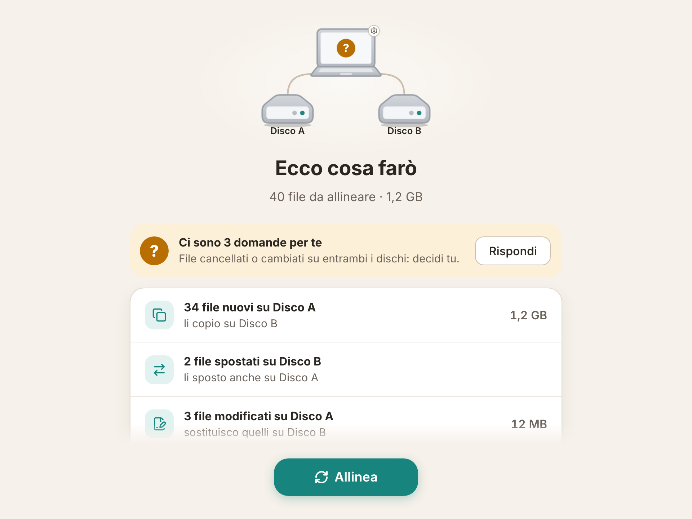
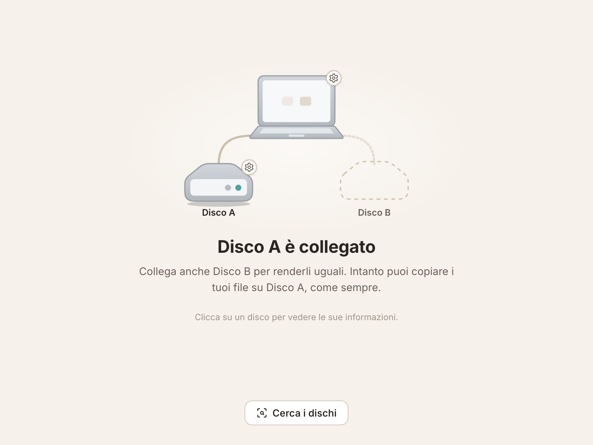
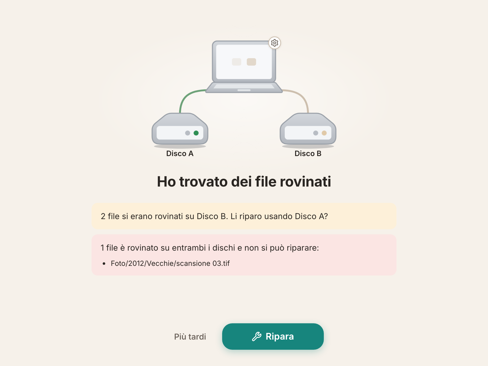

# HddRaid

[](https://github.com/GiacomoGuaresi/HddRaid/actions/workflows/ci.yml)
[](LICENSE)

*[Read in English](README.md)*

Un'app desktop che tiene **due hard disk esterni uguali**, come un RAID 1 ma
gestito dall'app invece che dall'hardware. I dischi restano normali dischi
exFAT, leggibili su qualsiasi computer anche senza l'app.

Pensata per chi usa pochissimo il computer: una cosa alla volta, pochi
pulsanti, nessuna parola tecnica, e niente viene cancellato senza chiedere.



## Cosa fa

- Carichi foto e documenti su **uno qualsiasi** dei due dischi, come sempre
  (Esplora file, Finder…).
- Quando colleghi entrambi i dischi, l'app se ne accorge da sola, ti mostra
  cosa è cambiato e con un pulsante **Allinea** li rende uguali.
- Ogni qualche mese legge tutti i file di entrambi i dischi, trova quelli che
  si sono rovinati (bit rot) e li ripara dalla copia buona.

## Stato

Versione 0.1.0, una pre-release: gli installer per Windows, macOS e Linux
sono nella [pagina delle release](https://github.com/GiacomoGuaresi/HddRaid/releases).

| Parte | Stato |
|---|---|
| Motore (scansione, confronto a tre vie, copia sicura, journal, controllo completo con riparazione) | fatto, con test |
| App desktop (icona nella barra, avvio automatico, rilevamento dei dischi, allineamento, domande, controllo completo, impostazioni, storico) | fatta |
| Formattazione exFAT sui tre sistemi, sostituzione di un disco rotto | fatto |
| Preparazione guidata al primo avvio | in corso |
| Installer costruiti dalla CI | fatto, senza firma del codice |
| Aggiornamenti automatici, pagina di download | da fare |
| Prova sul campo con i miei dischi | da fare |

Non ha ancora lavorato su dischi veri da qualche terabyte: non affidarle
l'unica copia di qualcosa. Il piano completo è nella [roadmap](doc/roadmap.md).

## Provarla

**Installarla.** Scarica l'installer per il tuo sistema dall'[ultima
release](https://github.com/GiacomoGuaresi/HddRaid/releases). Gli installer
non hanno la firma del codice, quindi al primo avvio il sistema avvisa: su
Windows *Ulteriori informazioni → Esegui comunque*; su macOS *Impostazioni di
Sistema → Privacy e sicurezza → Apri comunque*.

**Oppure compilarla dai sorgenti.** Servono [Rust](https://rustup.rs/) stabile, Node.js 24 e
[pnpm](https://pnpm.io/). Su Linux anche le dipendenze di Tauri
(`libwebkit2gtk-4.1-dev`, `libappindicator3-dev`, `librsvg2-dev`).

**Solo l'interfaccia, nel browser.** Senza dischi e senza compilare Rust: un
backend simulato mostra tutte le schermate.

```sh
cd app && pnpm install && pnpm dev
# poi apri l'indirizzo stampato e scegli uno scenario dal menu in alto a destra
```

**Il motore, su due dischi simulati.** Due cartelle fanno da disco A e disco
B; fuori da `dev-disks/` non viene toccato niente.

```sh
# crea i due dischi finti e li abbina
cargo run -p hddraid-devtools --bin dev-disks -- setup
cargo run -p hddraid-cli -- init dev-disks/disk-a dev-disks/disk-b
cargo run -p hddraid-cli -- sync dev-disks/disk-a dev-disks/disk-b --yes

# li rompe in tutti i modi insieme: file nuovi, modificati, cancellati,
# spostati e in conflitto, un byte rovinato, file di sistema…
cargo run -p hddraid-devtools --bin dev-disks -- break all

# mostra il piano, fa le domande, allinea
cargo run -p hddraid-cli -- sync dev-disks/disk-a dev-disks/disk-b

# legge tutti i file e ripara quello rovinato
cargo run -p hddraid-cli -- check dev-disks/disk-a dev-disks/disk-b --repair
```

**L'app vera**, sugli stessi dischi simulati:

```sh
cd app && HDDRAID_DEV_DISKS="$PWD/../dev-disks/disk-a:$PWD/../dev-disks/disk-b" pnpm tauri dev
```

Il resto è in [doc/sviluppo.md](doc/sviluppo.md).

## Cosa succede quando…

| Situazione | Cosa fa l'app |
|---|---|
| **È collegato un solo disco** | Lo dice e aspetta l'altro. Il disco si può usare normalmente: le novità passano sull'altro la prossima volta che sono collegati entrambi. |
| **Un file è nuovo o modificato su un disco** | Compare nel riepilogo e viene copiato sull'altro disco quando premi Allinea. |
| **Un file è stato spostato o rinominato** | Viene spostato anche sull'altro disco, senza ricopiarlo (lo riconosce dall'hash). |
| **Un file è stato cancellato da un disco** | L'app chiede sempre, file per file: cancellarlo anche dall'altro disco, o rimetterlo. |
| **Lo stesso file è cambiato in modo diverso sui due dischi** | Un conflitto, dichiarato solo dopo aver confrontato lo SHA-256 delle due versioni. Scegli tu: tieni A, tieni B, o tienile entrambe (una viene rinominata). Finché non rispondi quel file non viene toccato e il resto si allinea. |
| **Lo stesso file è stato aggiunto su entrambi i dischi** | Stesso checksum, quindi nessun conflitto e nessuna domanda. |
| **Un file si è rovinato su un disco** | Il controllo completo lo trova (stessa dimensione e data, hash diverso) e propone di ripararlo dall'altro disco. Se è rovinato su entrambi, l'app avvisa e non tocca niente. |
| **Un disco viene scollegato, o salta la corrente, durante una copia** | L'originale viene sostituito solo quando la nuova copia è scritta per intero, salvata sul disco e verificata. Un journal registra l'operazione in corso, e al giro successivo l'app ripulisce e riprende. |
| **Un file cambia tra il riepilogo e la copia** | Quel file viene saltato e ripreso al giro successivo. |
| **Un disco si rompe** | Colleghi un disco nuovo, lo formatti dal suo popup, e al prossimo allineamento l'app ci copia tutto dal disco sano. |

Le regole precise, con la tabella completa dei casi, sono in
[doc/sincronizzazione.md](doc/sincronizzazione.md).

<p>
  
  
</p>

## Come funziona

- **Confronto a tre vie.** Se un file c'è su A e manca su B, guardando solo i
  dischi non si può sapere se è stato aggiunto su A o cancellato da B. Per
  questo ogni disco porta con sé un indice (SQLite) dei file com'erano dopo
  l'ultimo allineamento riuscito, e ogni disco si confronta con quella base,
  non con l'altro disco. È la stessa idea di git e Syncthing.
- **Veloce quando non è cambiato niente.** L'allineamento normale si fida di
  dimensione e data di modifica, quindi su due dischi già allineati dura
  pochi secondi. Il contenuto si legge solo dove serve per decidere (file
  modificati, possibili conflitti, possibili spostamenti).
- **Copia sicura.** File temporaneo → `fsync` → verifica dell'hash rispetto
  alla sorgente → rinomina. Un'interruzione lascia il file vecchio o quello
  nuovo, mai uno a metà.
- **Le particolarità di exFAT sono gestite.** Nomi senza distinzione tra
  maiuscole e minuscole, Unicode scritto in NFD da macOS e in NFC da Windows,
  date confrontate con 2 secondi di tolleranza.
- **L'indice sta sui dischi**, quindi la coppia si può collegare a qualsiasi
  computer con l'app.

Il motore è un crate Rust senza dipendenze dall'interfaccia
(`crates/hddraid-core`); l'app [Tauri 2](https://tauri.app/), con interfaccia
in Svelte + TypeScript, si limita a chiamarlo. Cosa scrive l'app sui dischi è
descritto in [doc/formato-dati.md](doc/formato-dati.md).

## Test

È uno strumento che tocca i dati, quindi i test stanno nel motore: 92 test in
Rust, eseguiti dalla CI su Windows, macOS e Linux a ogni push.

- **Piano** (18 test): ogni riga della tabella dei casi — file nuovi,
  modificati, cancellati, spostati, conflitti, stesso contenuto con date
  diverse, cambi di sole maiuscole, cartelle vuote.
- **Allineamento** (20 test): il piano applicato a due dischi simulati,
  compresi gli scenari di guasto — un'operazione interrotta viene segnalata e
  sistemata, un file che cambia dopo il piano viene saltato, un disco che
  rientra viene riempito di nuovo, la cartella dell'app non viene mai
  allineata.
- **Controllo completo** (6 test): bit rot trovato e riparato, file rovinato
  su entrambi i dischi segnalato come perso, un file modificato non scambiato
  per rovinato, un controllo interrotto riprende, un disco scollegato mette
  in pausa il controllo.
- Il resto copre i mattoni: copia sicura, indice, scanner, hash, identità del
  disco, rilevamento dei volumi.
- **Volumi exFAT veri**: sul runner macOS, `scripts/exfat-e2e.sh` crea due
  immagini disco exFAT, le monta, fa un giro completo (preparazione,
  allineamento, tutti gli scenari di rottura, controllo completo con
  riparazione) e verifica che alla fine i due dischi siano uguali.

Cosa non è coperto: l'interfaccia ha il controllo dei tipi e quello delle
traduzioni (italiano e inglese devono avere le stesse chiavi) ma nessun test
automatico, e l'app non ha ancora fatto un giro lungo su dischi veri da
qualche terabyte.

```sh
cargo test --workspace
```

## HddRaid e PhotoSaver

[PhotoSaver](https://github.com/GiacomoGuaresi/PhotoSaver) è venuto prima:
un'app Python + Qt che tiene anche lei due dischi in mirror, ma ci costruisce
intorno molto altro — caricamento guidato, visualizzatore, miniature, mappa.
HddRaid è la stessa idea di fondo con tutto il resto tolto, riscritta per un
utente diverso.

| | PhotoSaver | HddRaid |
|---|---|---|
| Per chi | chi gestisce un archivio di foto dall'app | chi usa pochissimo il computer |
| Come arrivano i file sui dischi | caricati dall'app | copiati con Esplora file / Finder, su uno qualsiasi dei due |
| Cosa fa | archivio foto: caricamento, consultazione, ricerca, mappa | solo tenere uguali i due dischi |
| Cosa viene allineato | le foto, filtrate per tipo | tutto il disco |
| Dove sta l'app | portabile, sul disco | installata sul computer, nella barra di sistema |
| Stack | Python, PySide6 | Rust, Tauri 2, Svelte |

Ripresi da PhotoSaver: il mirroring a livello di app su normali dischi exFAT,
l'indice SQLite sui dischi, la copia sicura, il journal, il controllo completo
contro il bit rot. I dettagli sono in [doc/README.md](doc/README.md#da-photosaver).

## Cosa ho imparato di Rust qui

Rust è un linguaggio che sto ancora imparando, e questo è il progetto su cui
lo sto facendo. Le cose che mi sono rimaste:

- **Gli errori come valori.** Un solo enum `Error` per tutto il motore
  (`thiserror`), `?` ovunque, nessun panic nei percorsi che scrivono sui
  dischi. Casi come "la sorgente è cambiata durante la copia" o "spazio
  insufficiente" sono varianti che chi chiama deve gestire, non stringhe.
- **Gli enum per modellare il dominio.** Il piano di allineamento è un elenco
  di `Action` e `Question`; `match` obbliga a gestire ogni caso della tabella,
  e quando si aggiunge un caso il compilatore indica quelli dimenticati.
- **Un workspace per tenere il motore lontano dall'interfaccia.** Quattro
  crate: il motore, i dischi simulati (usati dai test e dalle prove a mano),
  una CLI di debug e l'app Tauri. Il motore era finito e testato prima che
  esistesse una schermata.
- **Thread con scope e canali.** Il controllo completo legge i due dischi in
  parallelo con `std::thread::scope` e un canale `mpsc`, con un `AtomicBool`
  per annullare: nessun runtime async.
- **Il codice di piattaforma dietro `cfg`.** Rilevamento dei volumi,
  formattazione, espulsione e `fsync` sono diversi su Windows, macOS e Linux;
  è la CI sui tre sistemi ad aver trovato gli errori solo di Windows (`fsync`
  sull'indice, riapertura da un'altra cartella).

## Come è stato costruito

Il codice è stato scritto con un assistente IA (ogni commit è co-firmato): io
ho scritto i requisiti e i documenti di progetto in [`doc/`](doc/README.md),
deciso le regole dell'allineamento, letto e approvato ogni modifica prima che
entrasse. Uno step della roadmap per commit.

## Documentazione

In [`doc/`](doc/README.md): obiettivo, schermate e flussi, regole di
sincronizzazione, formato dei dati, stack, roadmap, sviluppo.

## Licenza

[MIT](LICENSE)
