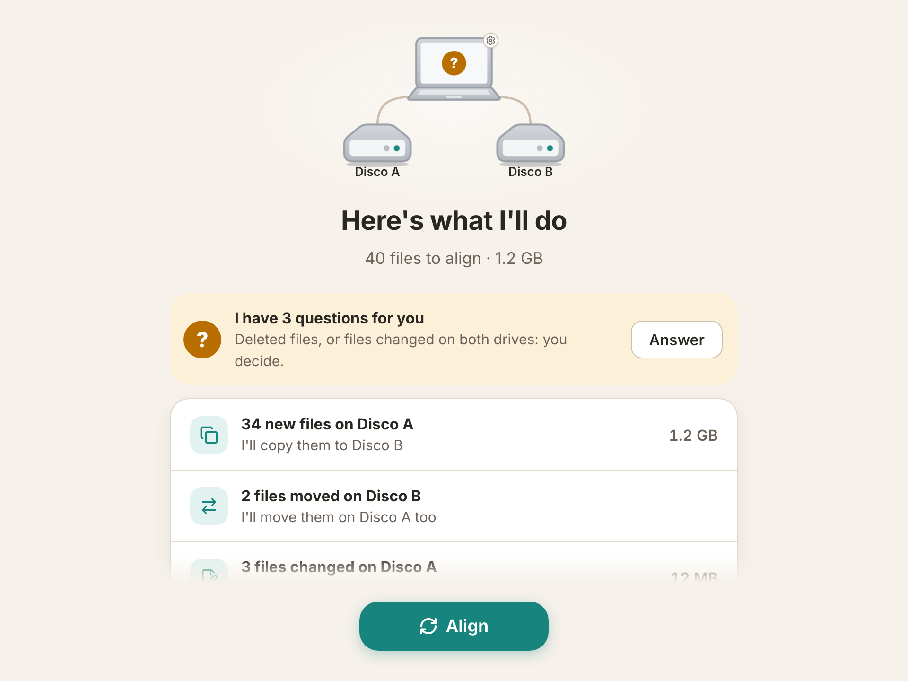
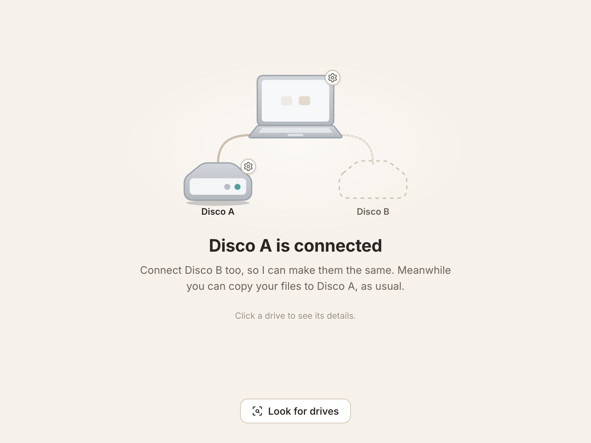
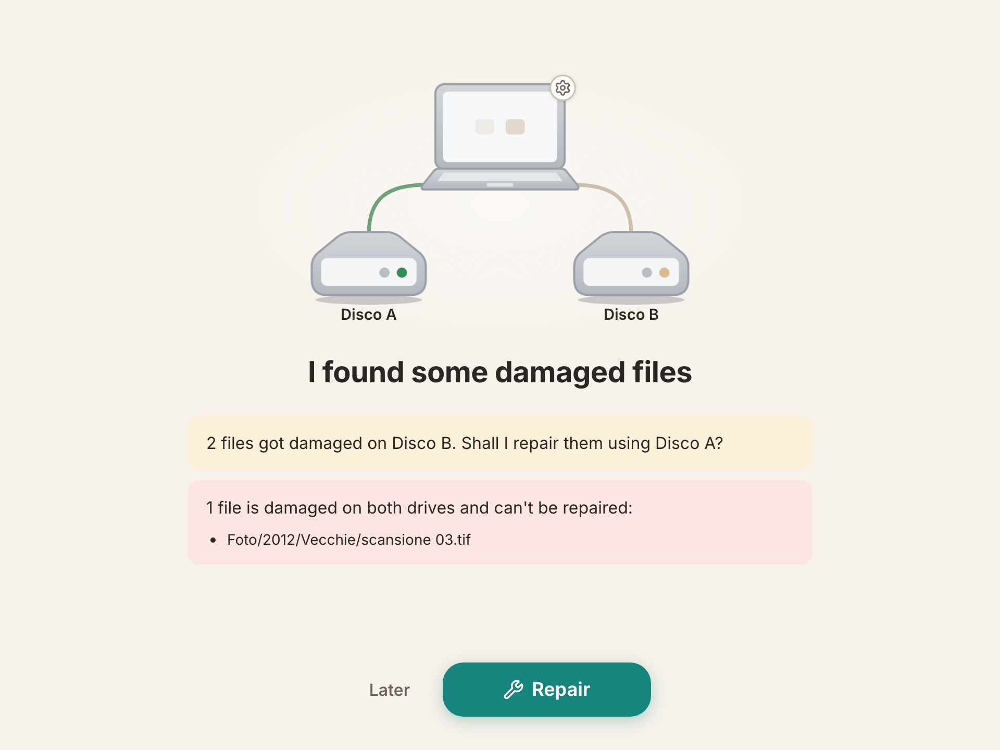

# HddRaid

[](https://github.com/GiacomoGuaresi/HddRaid/actions/workflows/ci.yml)
[](LICENSE)

*[Leggi in italiano](README.it.md)*

A desktop app that keeps **two external hard drives identical**, like a RAID 1
handled by the app instead of by hardware. The drives stay plain exFAT drives,
readable on any computer even without the app.

Built for people who barely use a computer: one thing at a time, few buttons,
no technical words, and nothing is ever deleted without asking.



## What it does

- You copy photos and documents to **either** drive, as usual (File Explorer,
  Finder…).
- When both drives are plugged in, the app notices on its own, shows what
  changed, and one **Align** button makes them the same.
- Every few months it reads every file on both drives, finds the ones that got
  corrupted (bit rot) and repairs them from the good copy.

## Status

Version 0.1.0, an early pre-release: installers for Windows, macOS and Linux
are on the [releases page](https://github.com/GiacomoGuaresi/HddRaid/releases).

| Part | State |
|---|---|
| Sync engine (scan, three-way compare, safe copy, journal, full check with repair) | done, tested |
| Desktop app (tray icon, autostart, drive detection, align, questions, full check, settings, history) | done |
| exFAT formatting on all three systems, replacing a dead drive | done |
| Guided first-time setup | in progress |
| Installers built by CI | done, not code-signed |
| Auto-update, download page | not started |
| Field test on my own drives | not started |

It has not yet run on real multi-terabyte drives: do not trust it with your
only copy of anything. The full plan is in the [roadmap](doc/roadmap.md).

## Try it

**Install it.** Download the installer for your system from the
[latest release](https://github.com/GiacomoGuaresi/HddRaid/releases). The
installers are not code-signed, so the system warns at first launch: on
Windows choose *More info → Run anyway*; on macOS open *System Settings →
Privacy & Security → Open Anyway*.

**Or build from source.** Requirements: [Rust](https://rustup.rs/) stable, Node.js 24 and
[pnpm](https://pnpm.io/). On Linux also the Tauri dependencies
(`libwebkit2gtk-4.1-dev`, `libappindicator3-dev`, `librsvg2-dev`).

**Just the interface, in a browser.** No drives and no Rust build needed: a
simulated backend plays every screen.

```sh
cd app && pnpm install && pnpm dev
# then open the printed URL and pick a scenario from the menu at the top right
```

**The engine, on two simulated drives.** Two folders stand in for drive A and
drive B; nothing outside `dev-disks/` is touched.

```sh
# create the two fake drives and pair them
cargo run -p hddraid-devtools --bin dev-disks -- setup
cargo run -p hddraid-cli -- init dev-disks/disk-a dev-disks/disk-b
cargo run -p hddraid-cli -- sync dev-disks/disk-a dev-disks/disk-b --yes

# break them in every way at once: new, changed, deleted, moved and
# conflicting files, a corrupted byte, system files…
cargo run -p hddraid-devtools --bin dev-disks -- break all

# see the plan, answer the questions, align
cargo run -p hddraid-cli -- sync dev-disks/disk-a dev-disks/disk-b

# read every file and repair the corrupted one
cargo run -p hddraid-cli -- check dev-disks/disk-a dev-disks/disk-b --repair
```

**The real app**, on the same simulated drives:

```sh
cd app && HDDRAID_DEV_DISKS="$PWD/../dev-disks/disk-a:$PWD/../dev-disks/disk-b" pnpm tauri dev
```

More in [doc/sviluppo.md](doc/sviluppo.md).

## What happens when…

| Situation | What the app does |
|---|---|
| **Only one drive is plugged in** | It says so and waits for the other. You can keep using the drive: the changes go across the next time both are connected. |
| **A file is new or changed on one drive** | It is listed in the summary and copied to the other drive when you press Align. |
| **A file was moved or renamed** | It is moved on the other drive too, without copying it again (recognised by its hash). |
| **A file was deleted from one drive** | The app always asks, file by file: delete it from the other drive too, or put it back. |
| **The same file changed differently on both drives** | A conflict, declared only after comparing the SHA-256 of the two versions. You choose: keep A, keep B, or keep both (one is renamed). Until you answer, that file is left alone and the rest is aligned. |
| **The same file was added to both drives** | Same checksum, so no conflict and no question. |
| **A file got corrupted on one drive** | The full check finds it (same size and date, different hash) and offers to repair it from the other drive. If it is corrupted on both, the app says so and touches nothing. |
| **A drive is unplugged, or the power goes, mid-copy** | The original is replaced only after the new copy is fully written, flushed to disk and verified. A journal records the operation in progress, and the next run cleans up and resumes. |
| **A file changes between the summary and the copy** | That file is skipped and picked up on the next run. |
| **A drive dies** | Plug in a new one, format it from its popup, and the next align fills it from the healthy drive. |

The exact rules, including the full table of cases, are in
[doc/sincronizzazione.md](doc/sincronizzazione.md).

<p>
  
  
</p>

## How it works

- **Three-way compare.** If a file is on A and missing on B, looking at the
  drives alone cannot tell whether it was added to A or deleted from B. So each
  drive carries an index (SQLite) of the files as they were after the last
  successful align, and each drive is compared with that base, not with the
  other drive. It is the same idea git and Syncthing use.
- **Cheap when nothing changed.** A normal align trusts size and modification
  date, so an already aligned pair takes seconds. Content is hashed only where
  it is needed to decide (changed files, possible conflicts, possible moves).
- **Safe copy.** Temporary file → `fsync` → hash check against the source →
  rename. An interruption leaves the old file or the new one, never half of
  one.
- **exFAT quirks handled.** Case-insensitive names, Unicode written as NFD by
  macOS and NFC by Windows, timestamps compared with a 2-second tolerance.
- **The index lives on the drives**, so the pair can be plugged into any
  computer with the app.

The engine is a Rust crate with no UI dependency (`crates/hddraid-core`); the
[Tauri 2](https://tauri.app/) app, with a Svelte + TypeScript interface, only
calls it. What the app writes on the drives is described in
[doc/formato-dati.md](doc/formato-dati.md).

## Tests

It is a tool that touches data, so the engine is where the tests are: 92 Rust
tests, run by CI on Windows, macOS and Linux on every push.

- **Plan** (18 tests): every row of the table of cases — new, changed,
  deleted, moved, conflicts, same content with different dates, case-only
  renames, empty folders.
- **Sync** (20 tests): the plan applied to two simulated drives, including
  failure scenarios — an interrupted operation is reported and healed, a file
  that changes after the plan is skipped, a rejoined drive is refilled, the
  app's own folder is never synced.
- **Full check** (6 tests): bit rot found and repaired, corruption on both
  sides reported as lost, a modified file not mistaken for corruption, an
  interrupted check resumes, an unplugged drive pauses the check.
- The rest covers the building blocks: safe copy, index, scanner, hashing,
  drive identity, volume detection.
- **Real exFAT volumes**: on the macOS runner, `scripts/exfat-e2e.sh` creates
  two exFAT disk images, mounts them, runs the whole cycle (setup, align, all
  the break scenarios, full check with repair) and verifies that the two
  drives end up identical.

What is not covered: the interface has type checks and a translation check
(Italian and English must have the same keys) but no automated UI tests, and
the app has not yet been through a long run on real multi-terabyte drives.

```sh
cargo test --workspace
```

## HddRaid and PhotoSaver

[PhotoSaver](https://github.com/GiacomoGuaresi/PhotoSaver) came first: a
Python + Qt app that also mirrors two drives, but does much more around it —
guided upload, a viewer, thumbnails, a map. HddRaid is the same core idea with
everything else removed, rewritten for a different user.

| | PhotoSaver | HddRaid |
|---|---|---|
| For | someone who manages a photo archive from the app | someone who barely uses a computer |
| How files get on the drives | uploaded through the app | copied with File Explorer / Finder, to either drive |
| Scope | photo archive: upload, browse, search, map | only keep the two drives identical |
| What is mirrored | photos, filtered by type | the whole drive |
| Where the app lives | portable, on the drive | installed on the computer, in the tray |
| Stack | Python, PySide6 | Rust, Tauri 2, Svelte |

Kept from PhotoSaver: mirroring at app level on plain exFAT drives, the SQLite
index on the drives, the safe copy, the journal, the full check for bit rot.
The details are in [doc/README.md](doc/README.md#da-photosaver).

## What I learned about Rust here

Rust is a language I am still learning, and this project is where I am doing
it. The things that stuck:

- **Errors as values.** One `Error` enum for the whole engine (`thiserror`),
  `?` everywhere, no panics on the paths that write to the drives. Cases such
  as "the source changed during the copy" or "not enough space" are variants
  the caller has to handle, not strings.
- **Enums to model the domain.** The sync plan is a list of `Action` and
  `Question` values; `match` forces every case of the table to be handled, and
  the compiler points out the ones I forgot when a new case is added.
- **A workspace to keep the engine away from the UI.** Four crates: the engine,
  the simulated drives (shared by tests and by manual tries), a debug CLI, and
  the Tauri app. The engine was finished and tested before any screen existed.
- **Scoped threads and channels.** The full check reads the two drives in
  parallel with `std::thread::scope` and an `mpsc` channel, with an
  `AtomicBool` to cancel — no async runtime needed.
- **Platform code behind `cfg`.** Volume detection, formatting, ejecting and
  `fsync` differ on Windows, macOS and Linux; CI on all three is what caught
  the Windows-only failures (`fsync` on the index, reopening it from another
  folder).

## How it was built

The code was written with an AI assistant (every commit is co-authored): I
wrote the requirements and the design documents in [`doc/`](doc/README.md),
decided the rules of the sync, and read and approved every change before it
went in. One step of the roadmap per commit.

## Documentation

In [`doc/`](doc/README.md), in Italian: goal, screens and flows, sync rules,
data format, stack, roadmap, development.

## License

[MIT](LICENSE)
